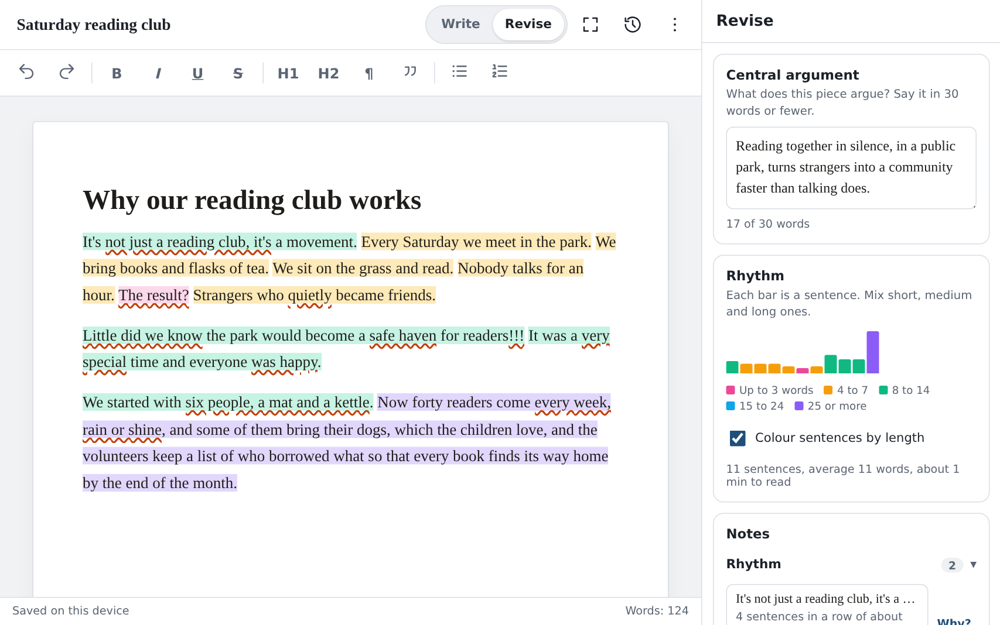
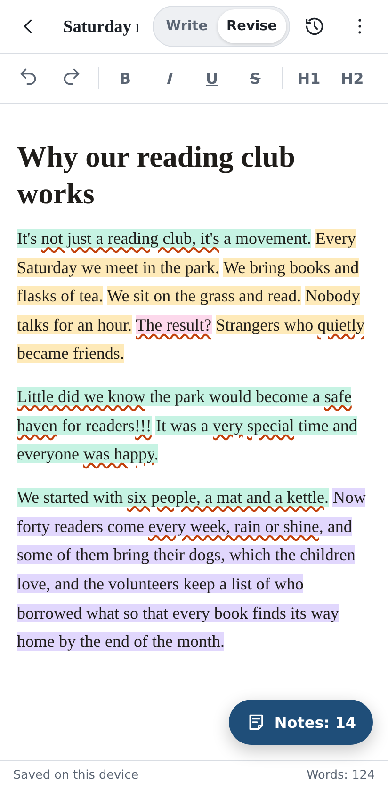
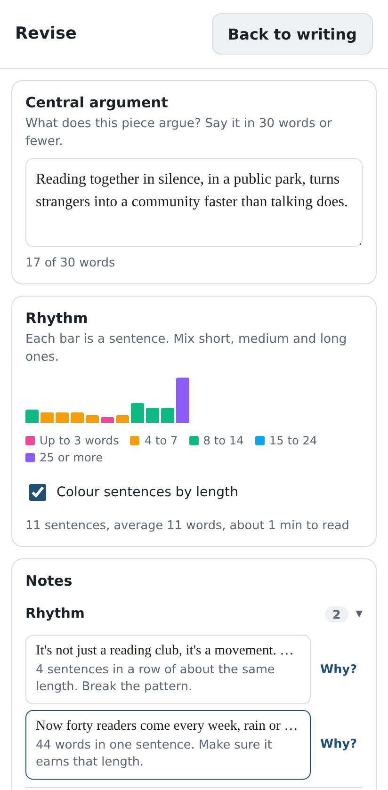
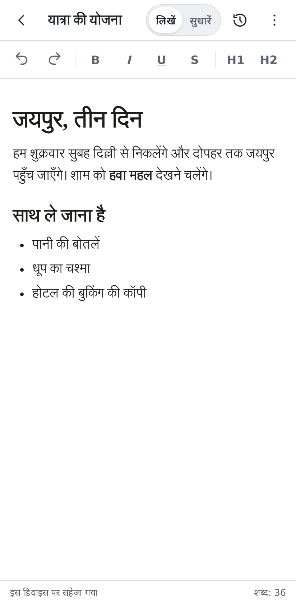
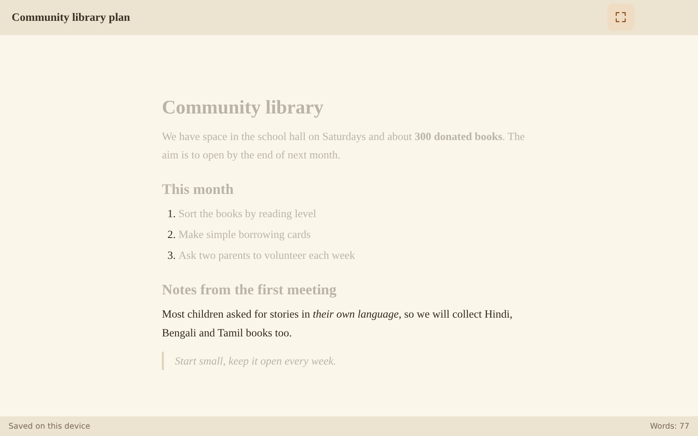
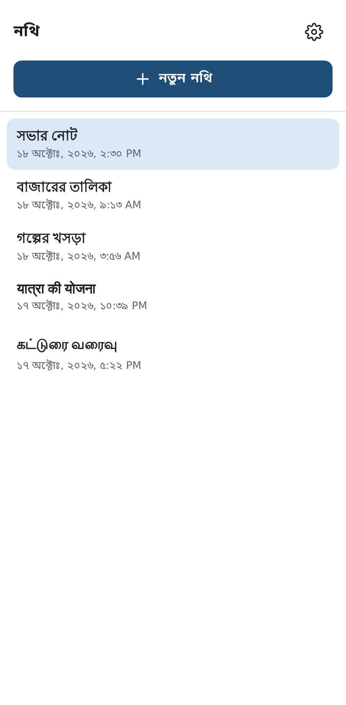
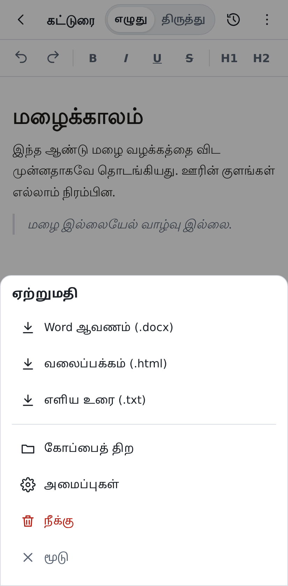
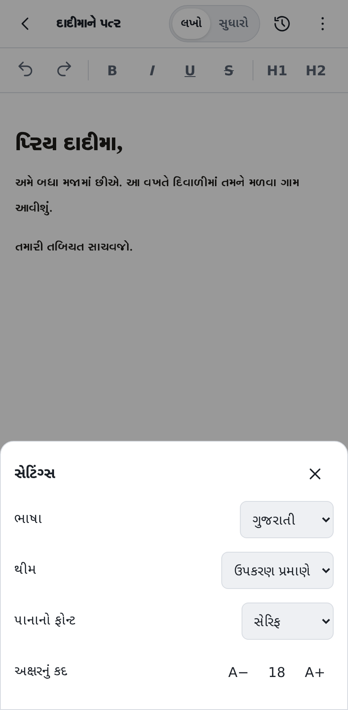
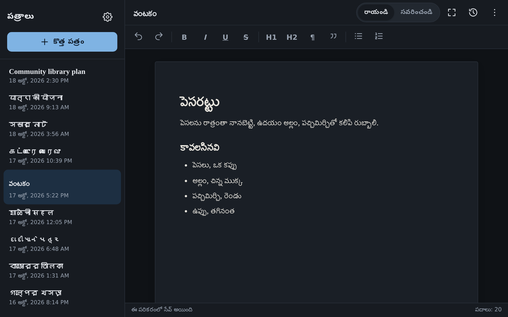
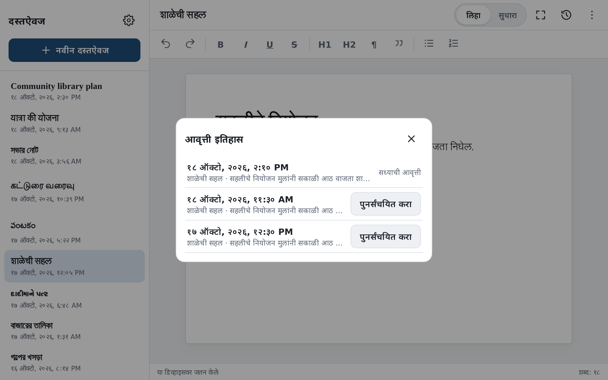

# Inkstand

Write a draft, then revise it until it says what you mean.

**Use it:** https://titasdas.github.io/inkstand/

I made [Readstand](https://implantintelligence.com/p/readstand) for reading on purpose and keeping what you learn. That's where ideas come in. Inkstand is for when they go back out: a quiet place to draft a piece and then sharpen it before you share it.

## Write, then revise

Inkstand has two modes. Write mode is for the first draft and keeps out of your way. On a tablet or computer, Focus dims every paragraph except the one you're working on.

Revise mode reads the draft and leaves notes. Each sentence is coloured by its length, so you can see the rhythm and spot a run of sentences that all sound the same. A box asks for your central argument in 30 words or fewer. The notes point out clichés, feelings you told instead of showed, and vague words. They also catch the habits that make writing sound machine-made, like "It's not X, it's Y" or a question answered in the next breath. Punctuation gets checked too, from doubled marks and missing spaces to crowded em dashes and lists that could use an Oxford comma.

Tap a note to jump to the words. "Why?" opens a short craft guide, and the practice sheet has exercises to warm up with.

The notes come from plain rules that run on your device. There's no AI behind them, and each one is a question you're free to answer with "I meant that."

  
  
  

## Phones, tablets and Indian languages

The interface comes in English, हिन्दी, বাংলা, मराठी, தமிழ், తెలుగు, ગુજરાતી, ಕನ್ನಡ, മലയാളം and ਪੰਜਾਬੀ, and opens in your device's language when it can. Rhythm and punctuation notes work in all of them, the Hindi danda included. The word-level notes read English for now.

  
  
  

## Your writing stays with you

After the first visit Inkstand works without a connection. It saves to your device as you type and keeps a version history you can go back to. Nothing is uploaded. When you're ready to share, export to Word (.docx), a web page or plain text.

  
  

## Install it

Open https://titasdas.github.io/inkstand/write/ in Chrome on Android, or Safari on iPhone and iPad, and choose Add to Home screen. It then opens like any other app, with or without a connection.

## Feedback

If something breaks, or a note is plainly wrong, please [open an issue](https://github.com/TitasDas/inkstand/issues).

## About this repository

This repository holds the published build of Inkstand. The source is developed privately. Inkstand is free to use, but the code isn't licensed for reuse (see [LICENSE](LICENSE)).

Made by Titas Das.
